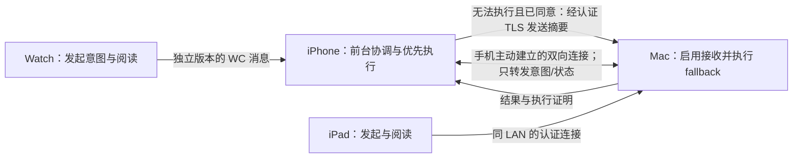

# 本地 AI 的设备路由与数据契约

日期：2026-11-20。状态：基于当前源码的设计建议，供主 agent 集成与用户审阅；本文没有实现推理、网络服务或后台任务，也没有运行构建、测试或真机验收。模型选择与硬件门槛由本轮其他研究文档给出。

## 推荐范围

首版支持用户主动生成「每日复盘」和「习惯建议」。先在可执行的 iPhone 上运行；iPhone 明确不能执行时，允许转给用户事先配对并启用接收的 Mac。两端都不能执行时，保留已有记录和旧结果，说明原因。iPad、Watch 提供发起和阅读入口，首版不要求它们加载模型。

建议先交付 iPhone 本机推理，再接入**经过认证的 LAN 通道作为 Mac fallback**。当前账号密文同步可以继续同步已获授权的业务记录，但不把作业临时塞进 `AppSnapshot`，不让既有 Node vault 处理推理明文。首版没有全天候推理、跨互联网唤醒手机或每日定时自动生成的承诺。

路由的「iPhone 优先」表示先检查已配对 iPhone 当前是否具备执行条件，并记录选择依据。无法连接 iPhone，只能得出「本次无法联系」，不能显示「iPhone 不支持模型」。Mac 也不能仅凭设备型号就承诺模型可用。

## 当前实现能复用什么

| 当前事实 | 对新增能力的含义 | 源码依据 |
| --- | --- | --- |
| `AppModel` 区分真实、示例、账号数据空间；健康查询有 generation 与 operationID，空间切换会断开健康 | AI 任务需要相同的异步失效规则；不能让旧任务写进新账号 | [AppModel](../../Packages/MyEnergyKit/Sources/MyEnergyUI/AppModel.swift) |
| `AppDeviceCoordinator` 分开处理账号同步与 Watch 通道，Watch namespace 包含服务范围和账户 | AI 的请求、进度、结果也应分开，不能把记录同步成功写成 AI 已运行 | [设备协调器](../../Packages/MyEnergyKit/Sources/MyEnergyUI/AppModel+Sync.swift) |
| Watch wire v2 只认识 snapshot 与 ACK，有 60 KiB 上限、因果基线和持久化后确认 | 不能直接把新的 AI 消息塞进旧 wire；需独立消息版本或兼容升级，旧端应返回不支持 | [WatchBridge](../../Packages/MyEnergyKit/Sources/MyEnergyPlatform/WatchBridge.swift) |
| `VaultCrypto` 只能编码、加解密 `AppSnapshot`；AES-GCM 的 AAD 是 `accountID` | 当前没有通用推理信封加密接口；复用算法不等于已有作业协议 | [VaultCrypto](../../Packages/MyEnergyKit/Sources/MyEnergyPlatform/VaultCrypto.swift) |
| 服务端只有 auth/session/account 和单份 vault 的 revision CAS、mutationID 去重 | 当前没有设备注册、能力心跳、作业队列、租约、结果投递或取消接口 | [Server](../../Server/server.mjs) |
| 账号会话和 vault key 分开；已有账号需要主动导入原恢复密钥，密钥按 serverScope/accountID 存储 | 「登录同一账号」与「本机具备解密能力」是两个状态，不能合并成一个已连接状态 | [AccountController](../../Packages/MyEnergyKit/Sources/MyEnergyUI/AccountSettingsView.swift) |
| `AccountClient` 只允许 HTTPS，HTTP 仅限 loopback；开发身份也仅允许 loopback 服务 | 不能通过放宽到任意 LAN HTTP 来完成跨真机验收；本机开发身份并非真实 Apple 互联 | [AccountClient](../../Packages/MyEnergyKit/Sources/MyEnergyPlatform/AccountClient.swift)、[Server](../../Server/server.mjs) |
| `HealthReport` 留本机，`SharedHealthSummary` 只有用户主动共享的当前摘要 | 原始 HealthKit 历史不能因新增 AI 自动同步；已有摘要共享也不等于同意让模型处理 | [共享契约](../implementation/contracts.md)、[SharedHealthSummary](../../Packages/MyEnergyKit/Sources/MyEnergyCore/SharedHealthSummary.swift) |

## 两条传输路径的取舍

| 方案 | 可取之处 | 本项目需要新增的工作 | 首版结论 |
| --- | --- | --- | --- |
| 新增账号加密 mailbox/queue，服务端仅保存密文 | 可跨网络保留短期请求和结果；沿用 session 账户隔离、SQLite、重试思路 | 独立表/API、设备注册与撤销、收件人密钥、AAD 版本、租约 CAS、TTL、取消墓碑、投递 ACK、账户删除级联；每个执行端仍须主动取件，不能借队列保证 iPhone 后台执行 | 有实际跨网络需求、已有可用 HTTPS 服务之后再做 |
| 把 jobs 加入现有单份 `AppSnapshot` 密文 | 表面上可复用 vault 的上传下载 | 必须改公共 schema、实体合并与删除语义；高频心跳/进度会和业务记录争用整份 vault；旧客户端可能丢失未知字段；快照三方合并不等于单执行者领取 | 不推荐 |
| 独立的认证 LAN 通道，Mac 接收连接，iPhone 主动连接 | 不增加付费服务或正式部署；可先验证真实本地推理；手机不必常驻监听 | 设备配对、TLS 与证书固定、账户/密钥证明、局域网权限、有限消息协议、重连与去重；只保证已连接、正在运行的设备可用 | 推荐作为首版跨设备路径 |

LAN 的复杂性主要在首次配对与连接生命周期。账号队列的复杂性主要在跨设备状态机及服务可用性。两者都需要权限、取消和去重，不能用「同账号」省掉这些工作。如果用户只需要在 iPhone 生成并阅读，第一阶段完全可以不启用 LAN；这仍是可独立验收的本机 AI 能力。

若以后采用 mailbox，新增独立 `/v1/inference-messages` 一类密文消息协议即可，不改变现有 `/v1/vault` 的正文含义。服务端从 session 推导账户，不接收可越权的 accountID；外层只保留投递必需的随机请求 ID、收件设备 ID、过期时间和 CAS 状态，任务类型、日期、输入、输出和错误详情都在密文内。请求和结果需分方向、分用途派生密钥，AAD 至少绑定版本、serverScope、accountID、发件设备、收件设备、requestID、attemptID 和消息类型。既有 `VaultCrypto.seal(AppSnapshot)` 不应被绕过类型检查来充当此接口。

## 最小设备拓扑

Mac 打开 MyEnergy 并主动启用「接收本地 AI 请求」时，提供 LAN 接收端。iPhone 在用户开启跨设备 AI 且应用进入前台时主动连接。这个双向连接可让 Mac 或已配对 iPad 把无健康正文的意图交给 iPhone。Mac 不需要先接收手机的健康输入才能询问它是否可执行。

同一连接中只选一个协调者，通常是创建用户任务的设备；由它生成 requestID 并选择 attempt。iPhone 接到远端意图后，如需读取本机未共享数据，必须在 iPhone 上完成本次输入确认。不能因为另一端点了按钮就自动读取 HealthKit 或把未共享信息写进返回结果。

iPad 通过 Mac 中继取得 iPhone 的结果时，Mac 也会接触派生信息，授权页必须把 Mac 列为结果接收方。用户不允许 Mac 接触这份结果时，首版只在 iPhone 保存与展示，iPad 显示「已在 iPhone 生成，请到 iPhone 阅读」；不能借中继之名绕过结果共享许可。以后如需对中继隐藏结果，需增加 iPhone/iPad 独立配对与端到端结果信封，另列实现范围。

四端的明确边界如下：

| 发起设备 | 优先路径 | 降级与说明 |
| --- | --- | --- |
| iPhone | 本机先做能力和输入检查，符合条件即执行 | 不能执行且允许 fallback，才把确认过的摘要送 Mac；Mac 不可达则结束本次尝试 |
| Watch | 发 task/day 意图给配对 iPhone；iPhone 确认输入并执行 | 只能承诺意图被保存/送达，不能把 ACK 当生成完成；用户需要时在 iPhone 打开应用 |
| iPad | 经已配对 Mac 的活跃 LAN 会话询问 iPhone，只传意图 | 没有活跃 iPhone 会话时，可在确认后把本机已持有的摘要交 Mac；无 Mac 会话则提示到 iPhone 运行 |
| Mac | 活跃 iPhone 会话可执行时把意图交它；iPhone 若需额外数据授权，在手机确认 | iPhone 不可达或明确拒绝后，用户已允许 Mac fallback 才在 Mac 本机运行；输入仅限当前 Mac 合法持有或本次获准接收的摘要 |

iPad 经 Mac 转发是首版拓扑选择，不宣称平台无法做 iPad ↔ iPhone 直连。若此交互成本超出首版范围，iPad 先只阅读结果和提供「到 iPhone 生成」入口，也应明确记录为已裁剪的验收范围，不能显示伪运行进度。

WatchConnectivity 能在一定条件下唤醒配对 iPhone 接收消息，但这不能作为长时间模型加载/推理的完成保证。本方案只在 iPhone 前台有明确执行条件时启动推理。Apple 将即时消息可达性与排队后台传输分开说明，后台到达时间也无即时保证。[WCSession](https://developer.apple.com/documentation/watchconnectivity/wcsession)、[Apple Watch 数据传输说明](https://developer.apple.com/videos/play/wwdc2021/10003/)

## 配对与账号隔离

将两种能力分别展示：`accountSessionValid` 表示账号会话有效；`vaultKeyVerified` 表示本机已导入并验证当前账户的恢复密钥。再有 `peerPaired`、`peerReady` 两个独立状态。设备发现、Apple 显示名、账号 ID 相同或短指纹相同都不是认证。

Watch 沿用系统配对通道和 iPhone 采用的账号 namespace，首版只委托配对 iPhone 发起任务，不假设 Watch 有独立 Apple 登录或 vault key。iPhone 对 Watch namespace、任务有效期和结果接收授权再核对后才执行；namespace 是路由标识，不能拿来证明任意 LAN 设备持有密钥。

推荐的最小配对过程：

1. 两端已进入相同 `serverScope + accountID` 空间；已有 vault 时，必须先成功解密一次来验证恢复密钥。空 vault 不能仅凭「32 字节」宣称密钥相同，还须完成下面的密钥持有证明。匿名空间仅允许本机推理；首版不提供匿名跨设备 AI。
2. Mac 用户主动打开有时限的配对窗口，展示二维码，包含随机的一次性高熵配对秘密、端点、TLS 证书公钥指纹、pairingID 和到期时间。首版可提供复制配对串作为无摄像头路径，不使用可离线枚举的短数字码作为长期凭据。
3. iPhone/iPad 扫描或粘贴后固定该证书身份，完成新鲜随机 challenge 的双向证明。双方另以从 vault key 按用途派生的密钥证明当前账户解密能力，证明绑定两端设备 ID、serverScope、accountID、pairingID、双方随机数和证书身份；不传 vault key，不复用 Apple token 作密钥，也不拿显示用的 6 字节 fingerprint 作认证。
4. 用户核对两端配对结果后，保存独立的每对设备凭据到各自 Keychain，按账户和服务范围隔离；一次性配对秘密失效。后续连接使用固定证书和独立设备凭据双向认证，再核对完整 scope。vault key 更换、账号切换、设备撤销使配对失效，重新配对。
5. Bonjour 若用于发现，只广播通用服务类型、随机临时实例标识和协议版本，不广播账户、健康状态、任务日期或模型输入。发现结果不能替代第 3 步认证。

这是协议需求，落地应使用系统 TLS/CryptoKit 等现成密码能力，并对握手做独立 review。复用账户级对称密钥证明只表明对端持有该 key，不能抵御已经持有该 key 的恶意同账户设备冒充；独立配对凭据和可撤销设备记录仍然必要。首版不是一个拥有设备远程证明能力的系统。

LAN 避免新增生产推理服务，但不会自动补齐当前真实账号前置条件。两台真设备首次取得同一账号会话，仍需已有可访问且受信任的 HTTPS 账号服务、正确的 Apple audience/团队配置及恢复密钥导入；不能把 loopback 开发鉴权通过反向代理暴露到 LAN。先以注入的隔离测试账户验证路由和密钥边界时，UI 与验收记录持续标记开发身份。本机 iPhone 推理不依赖这些跨设备前置条件，可先独立交付。

LAN 通道使用 Network.framework 的 TLS 能力，不通过放宽现有 `AccountClient` 来允许明文局域网 HTTP。Apple 的 TN3213 明确说明：Network.framework 的 TLS-PSK 不支持 TLS 1.3，且限于 `NWConnection` 等旧版 API。因此，本轮账号密钥 MVP 使用 TLS 1.2 与 `TLS_PSK_WITH_AES_128_GCM_SHA256`；账号密钥经独立用途 HKDF 派生后用于 PSK 认证。Apple 的 TicTacToe 官方示例也在配置 PSK 后显式添加这一套件，没有要求设置 identity hint。[TN3213](https://developer.apple.com/documentation/technotes/tn3213-moving-from-multipeer-connectivity-to-network-framework#Plan-for-security)、[官方示例](https://developer.apple.com/documentation/network/building-a-custom-peer-to-peer-protocol)

该 plain-PSK AES-GCM 套件提供密钥认证与加密，但不提供前向保密；若长期 PSK 泄露，先前被记录的会话也可能被解密。PSK identity 使用 namespace 摘要的十六进制字符串并按 UTF-8 编码，hint 保持缺省。前述证书固定和独立设备凭据仍属后续配对设计，不能算作本轮已有能力。TLS 配置与 loopback 测试都不能替代 iPhone 真机和 Mac 的局域网互联验收；本文没有宣称真机互联已通过。[RFC 5487 §2](https://www.rfc-editor.org/rfc/rfc5487.html#section-2)、[RFC 4279 §5.1–5.3、§7.1](https://www.rfc-editor.org/rfc/rfc4279.html#section-5.1)

局域网使用说明和 Bonjour 服务声明按实际需要添加，并在用户主动启用跨设备 AI 后请求。拒绝权限时仍可本机推理；状态显示「局域网权限未允许」。Simulator 不覆盖局域网隐私行为，真机单列验收。[NSLocalNetworkUsageDescription](https://developer.apple.com/documentation/bundleresources/information-property-list/nslocalnetworkusagedescription)、[TN3179](https://developer.apple.com/documentation/technotes/tn3179-understanding-local-network-privacy)

## 只传可审阅的任务输入

先由确定性代码从业务记录构造 `InferenceInput`，模型只接收这个值，不直接访问 AppModel、HealthKit、Keychain、文件系统或同步客户端。输入 schema 不提供备注、睡眠备注、原始 HealthKit 样本、Apple token、恢复密钥等字段；首版即使在本机也不读备注，避免同一任务 fallback 时无意扩大字段范围。

| 输入 | 首版允许的形式 | 跨设备条件 |
| --- | --- | --- |
| 主观精力 | 指定日及最多近 7 日的数量、均值/范围与缺失状态，明确时区 | 本次预览列明字段和时间范围 |
| 心情 | 用户已记录的心情分布与缺失状态 | 不由 HRV、睡眠或模型推断未填写的心情 |
| 习惯 | 活跃习惯数、完成/未完成次数与分母；目标不完整时说明缺失 | 自定义标题可能含敏感内容，默认用「习惯 1」等本任务别名；只有本次主动选择的标题才传 |
| 睡眠与恢复 | 当前摘要和来源、采样/更新时间、可用/过期/历史不足状态；手动睡眠只取必要时长，不取备注 | 单独的 AI 输入同意；默认不含健康。已有「共享健康摘要」不自动升级成 AI 同意；原始历史始终不传 |
| 来源与质量 | 每项来源 ID、是否本机/用户共享、有效范围、缺失原因 | 模型和 UI 都保留，不把旧摘要填成今日事实 |

首版不导出新的 7/30 天健康历史；已有当前摘要不足时，生成结果必须说明只依据主观记录/习惯。用户也可以只选择主观记录。启用健康连接、启用摘要同步、允许模型处理、允许发到另一设备是不同授权，不用一个总开关代替。

Mac fallback 的确认页展示接收设备、任务日期、输入类别及字段数量、健康摘要时间、是否包含习惯标题。没有当前许可时，停在「需要允许把这些摘要交给这台 Mac」；不得先发送后确认。健康输入原本仅在 iPhone 时，Mac 输出返回其他设备也属于派生健康信息共享，确认应覆盖结果接收设备；默认只回给发起端，其他端需主动选择。

## 建议的最小数据模型

这些类型是新契约建议，不是当前代码已存在的 API。公开值类型沿用 `Codable / Equatable / Sendable`，日期、时钟、ID 和执行器可注入；验证拒绝未知 schema、越界日期、过大正文和状态/字段矛盾。

| 类型 | 核心字段与约束 |
| --- | --- |
| `AIAccountContext` | `serverScope, accountID, keyVersion, namespace, accountGeneration`；完整 scope 是隔离键，不能仅用账号显示名或 storageURL 字符串代替身份 |
| `AIDeviceCapability` | `pairedDeviceID, kind, displayName, protocolVersion, supportedTasks, modelID, modelVersion, availability, observedAt, expiresAt`；型号/模型可用性由真实执行器返回，心跳过期即不能标就绪 |
| `AIRequestIntent` | `requestID, requesterDeviceID, taskKind(dailyReview/habitAdvice), dayKey, timeZoneIdentifier, createdAt, expiresAt, desiredInputScope`；没有记录正文，不能触发自动 HealthKit 查询 |
| `InferenceInput` | `schemaVersion, dayKey, timeZoneIdentifier, windowStart, windowEnd, subjectiveSummary, habitSummary, optionalCurrentHealthSummary, quality, sourceReferences`；结构化摘要白名单，不含自由备注、原始样本或提示词内嵌身份秘密 |
| `AIConsentReceipt` | `receiptID, context, allowedInputCategories, allowedHabitTitleIDs, inputDigest, receiverDeviceID, resultRecipientIDs, grantedAt, expiresAt`；对这份输入与接收设备有效，不能换设备继续用 |
| `AIRouteAttempt` | `requestID, attemptID, sequence, coordinatorDeviceID, targetDeviceID, inputDigest, promptVersion, policyVersion, startedAt, deadline, state, reason`；相同请求换设备必须新 attemptID |
| `AIResult` | `resultID, requestID, attemptID, taskKind, inputDigest, promptVersion, policyVersion, modelID, modelVersion, executedDeviceID, executedDeviceKind, startedAt, completedAt, evidenceSections, suggestions, limitations`；无成功执行元数据时不能伪造成 AI 结果 |
| `AITaskState` | `idle, preparing, awaitingConsent, checkingPhone, runningPhone, checkingMac, runningMac, completed, cancelled, expired, failed`；配套类型化 reason，UI 显示真实当前状态 |
| `AIUnavailableReason` | 至少含 `unsupportedOS, unsupportedHardware, modelUnavailable, modelLoading, insufficientMemory, thermalLimited, backgroundRestricted, needsForeground, networkDenied, peerUnreachable, peerBusy, unpaired, accountMismatch, keyUnverified, consentRequired, insufficientInput, expired, staleInput, cancelled` |
| `AITaskJournal` | 本机私有文件保存请求 ID、attempt、终态与去重记录；按完整账户 scope 分目录，原子写入并排除备份；已确认后才能发产品 ACK |

`inputDigest` 来自规范编码后的实际输入及 task/day/timezone/input schema，prompt/model/policy 版本另行入缓存键。摘要本身的哈希不要明文放到公开 LAN 广播或 vault 外层元数据；低熵健康值可能被枚举。

建议首版每个账户只允许一个活跃生成任务；输入上限 32 KiB、结果上限 16 KiB、等待用户批准最多 10 分钟、单次执行 deadline 120 秒。这些是可配置的保护上限，不是延迟承诺；需由模型实测收紧或调整。任务的日界与 7 日窗口在创建时固定，不随旅行或运行途中时区变化重算。

`AIResult` 首版保存到独立的 `ai-results` 私有存储，避免把新字段放入旧客户端可能重新编码覆盖的 `AppSnapshot`。结果同步若在首版启用，使用独立、明确授权的结果消息，不走 Watch snapshot 的整份历史路径。每个结果必须带输入截止时间、缺失项和执行设备。建议只是用户可采纳的候选，不自动修改习惯、健康记录或写 Apple Health。

## 选择设备与确认结果

1. 捕获当前完整 account context、存储空间、账号 generation；示例模式走单独标识的示例输入，禁止把真实结果放进示例或把示例同步给其他端。
2. 构造输入草案，用户确认类别。输入不足且两类任务都不能形成事实时，返回 `insufficientInput`，给出确定性说明；这不是一次 AI 运行成功。
3. 检查 iPhone 的真实能力与前台条件。本机 iPhone 直接检查；远端只在活跃认证连接中发意图探测。探测预算建议 3 秒，过时心跳只能显示「最近见到」，不能据此启动任务。
4. iPhone 可执行则绑定当前 attempt，开始生成。iPhone 明确不支持或无法开始，记录类型化原因。尚未开始的设备无需等待模型 deadline；正在运行且未终止的任务不能因探测超时就同时派给 Mac。
5. 需要 Mac 时，重新确认本次可传输入和接收设备，获取 Mac 当前能力，再创建新 attempt。Mac 自身是发起端时仍记录「iPhone 本次未执行原因」及「Mac 本机」执行路径。
6. 执行器先回 `accepted`，开始后回 `started`，成功后给结构化结果。进度只在有真实模型回调时显示；没有 token 进度就显示执行中，不制造百分比。
7. 协调者验证结果归属、attempt、inputDigest、授权、generation、期限和模型元数据，通过后原子保存，再发结果已保存 ACK。只有此时显示完成；网络送达、服务端存储、Watch ACK 都不能代替它。

## 取消、晚到结果与数据变化

取消有两个动作：协调者立即把本地任务记为终态，并尽力通知执行器停止。若模型 API 不能即时中断，停止消费输出并丢弃最终结果；UI 可说明「已取消，设备正在停止计算」。不要宣称远端物理计算已经停止。

| 触发事件 | 必须执行的失效动作 |
| --- | --- |
| 用户取消，或执行过期 | 取消当前 Task、记录 request/attempt 终态并发取消消息；重复与晚到消息只回复终态，不重跑 |
| 切换账号、服务地址、退出、导入/替换密钥 | 在等待之前提升 accountGeneration，撤销当前任务和授权；断开旧 scope 会话；旧结果不能保存、展示或写新账户 |
| 进入/退出示例 | 取消任务，切换独立输入与缓存空间；示例不经 LAN/账号通道 |
| 输入相关记录编辑、删除或同步改变 | 重新计算输入摘要；digest 改变则正在运行的结果无效，给出「记录已更新，请重新生成」；不因无关旧记录改变而一律取消 |
| 停止健康连接或撤回 AI 健康许可 | 取消依赖健康的任务，清掉暂存输入与结果预览；已经跨设备共享的结果/摘要按删除协议另行处理，明确尚未确认的远端清理 |
| 撤销 Mac 配对或本地接收权限 | 不再接受新任务；取消相关 attempt，删除配对凭据和该 peer 的临时输入，拒绝后续重放 |
| 删除本地记录或账号 | 清理对应 AI journal/结果和本机密钥；可达 peer 接收删除指令并落盘 ACK；离线 peer 的已保存副本只能在它重新连通处理撤销后确认清理 |
| 应用退后台、网络中断或重启 | 不假设任务仍可继续；恢复后仅查询同 attempt 的状态。执行器失去会话即取消，协调者在取消确认或 attempt deadline 后才可新建 Mac attempt |

第一版只保留一个有权发布的 attempt。若手机已经开始执行而 LAN 断开，Mac fallback 要等到手机终态确认或旧 attempt 期限结束，使用新 attemptID；迟到手机结果被拒绝。执行器也在接受请求时验证 deadline，并在运行中检查取消/截止时间。设备时钟偏差超过允许范围时拒绝远端执行，不靠墙上时间选结果赢家。

这保证最多一个结果被产品接受；网络分区和不可中断模型 API 下，不声称物理计算严格只发生一次。状态不明时宁可显示「等待前一设备结束」并让用户取消重试，也不让两端悄悄竞争。

短期重发复用同一 requestID/attemptID 和相同正文；执行器按账户、请求、attempt 去重，正文变了就拒绝。`accepted` 只在 journal 持久化后发，`completed` 只在结果持久化后发。终态去重至少保留到该 request 过期并经过迟到消息保留期，过期请求无论重启多少次都不能重新执行。首版不因恢复连接而自动重跑昨天未完成的任务。

## 可见结果与未执行原因

结果页至少显示「由你的 iPhone 生成」或「由已配对 Mac『设备名』生成」、完成时间、模型标识、依据日期及缺失项。设备名来自配对信息，不能取未经认证的广播名充当真实身份。更换后端或模板降级不能继续沿用上一次设备/模型标签。

常见状态文案应直接反映观测：

- 「iPhone 模型尚未准备好，本次尚未生成。允许后可交给『Mac 名称』处理以下摘要。」
- 「本次无法联系 iPhone，未判断它是否支持模型。」
- 「已把请求交给 iPhone，尚未开始。请在 iPhone 打开 MyEnergy。」
- 「Mac 未执行：尚未允许局域网访问。你可以在 iPhone 本机生成。」
- 「记录已更新，本次结果已失效。重新生成会使用当前记录。」

如果提供纯规则生成的记录概览，标为「记录概览 · 未运行 AI」，不显示模型名、AI 完成标识或虚构执行设备。没有新结果时可以展示旧结果，但必须标日期和「基于较早记录」，不能覆盖成今天。

## 实施边界与验收

实现时增加独立 `LocalAIService`/执行器接口、摘要 builder、路由协调器和 `AIResultStore`；UI 只订阅状态，模型不持有账号密钥。`AppModel` 暴露只读输入视图和明确的失效事件；`AppDeviceCoordinator` 可以装配 AI 协调器，但不把它并入 snapshot 三方合并或 Watch FIFO。LANTransport 和 Watch intent transport 分开，二者共用任务身份和终态语义。

| 验收项 | 需要的证据 |
| --- | --- |
| iPhone 优先 | 两端均就绪时只选择 iPhone；iPhone 不支持/模型未就绪/前台不满足/不可达分别得到真实原因，不能都显示同一「失败」 |
| Mac fallback | 手机明确无法开始后，在已确认的 Mac 上实际执行；页面显示真实设备、模型、输入截止时间。没有 Mac 时不伪成功 |
| 数据白名单 | 编码后的请求无备注、原始 HK 样本、token/key；健康默认空，选定健康/标题和接收设备前不出站；接收结果范围与授权一致 |
| 账号与密钥 | 同账号未导入 key 时不能跨设备 AI；不同账号/服务范围/错误 key/被撤销 peer/假 Bonjour 名称均拒绝；开发身份只记开发互联证据 |
| 取消和晚到 | 用可控异步执行器复现取消、切账号、切示例、改记录、撤授权、删账号后的晚到完成，不能落盘或覆盖当前状态 |
| 去重与分区 | 重发、重启、旧 ACK、旧结果、过期任务不造成新执行；手机已 started 后断连不立刻并发派 Mac；新 attempt 拒绝旧结果 |
| 日期与质量 | 午夜、夏令时、旅行、缺失/过期摘要正确；未填心情保留未知；未把 HRV 描述为情绪检测，不从相关性断言因果 |
| 四端降级 | Watch 意图 ACK 和 AI 完成分开；iPad 无活跃路由时给明确入口；旧 wire 版本显式拒绝；不自动传整份快照作为 AI 输入 |
| 服务边界 | 现有 Node 服务无 AI 明文 endpoint；若以后做 mailbox，抓包/日志/SQLite 检查只出现加密正文和必要投递元数据 |
| 真实设备 | iPhone 模型加载/取消/内存与后台条件、Mac 执行、LAN 拒绝与恢复、真实账号和配对 Watch 分别记录；Simulator/注入执行器不能替代这些证据 |

本文仅完成源码核对、方案比较与契约自审。未执行这些验收项，未改 Xcode 工程和 scheme，未影响当前两份用户签名/Run 未提交改动。
